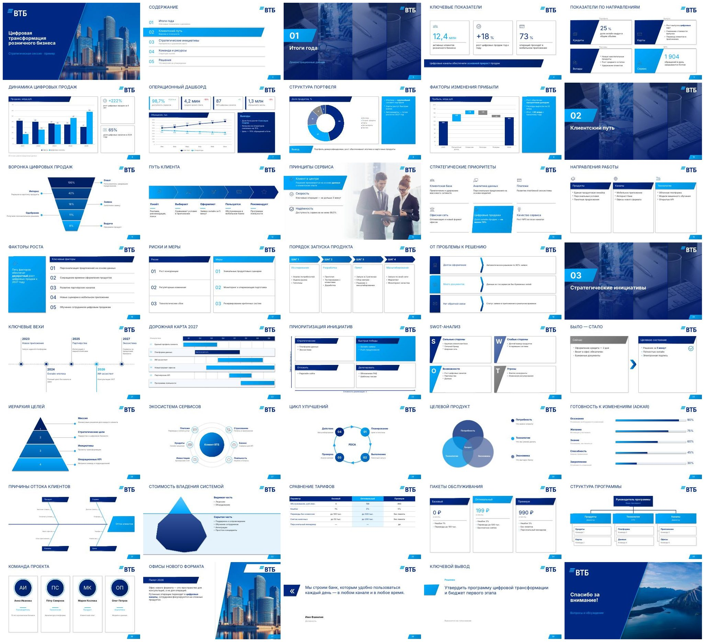

# VTB Slides — скилл для Claude

Скилл собирает презентации PowerPoint в фирменном стиле ВТБ: 20 титулов, 37 типов контентных слайдов, инфографика, нативные графики, таблицы. Основа — официальные шаблоны `16x9_титулы_RUS.pptx` и `16x9_внутренний_блок_светлый_стиль_RUS.pptx`. 72 категории схем из библиотеки `01-Powerpoint-Infographics` перерисованы в стиле ВТБ.



## Состав

```
skills/vtb-slides/
  SKILL.md                     инструкция для Claude (триггеры, типы слайдов, правила)
  scripts/vtb.py               библиотека: класс Deck, 37 типов слайдов, примитивы
  scripts/build_deck.py        сборка из JSON: python3 build_deck.py spec.json out.pptx
  assets/vtb_template.pptx     мастер ВТБ + 5 контентных макетов + 20 титулов (без слайдов)
  assets/icons/                34 фирменные иконки × 4 цвета (navy, cyan, white, gray), PNG
  assets/icons_svg/            исходные SVG иконок
  assets/photos/               9 фирменных фото из шаблона
  references/style-guide.md    сетка, цвета, шрифты, приёмы (снято с шаблонов)
  references/components.md     API всех методов
  references/infographics-map.md  72 категории инфографики → компоненты ВТБ
  references/covers.jpg, icons.png  превью титулов и иконок
  examples/demo.json           пример со всеми типами слайдов
examples/demo.pptx, demo.pdf   собранное демо (40 слайдов)
dist/vtb-slides.zip            архив скилла для загрузки
```

## Установка

- **Claude Code:** скопируйте `skills/vtb-slides` в `~/.claude/skills/` (для всех проектов) или в `.claude/skills/` проекта.
- **Claude.ai:** Настройки → Capabilities → Skills → загрузить `dist/vtb-slides.zip`.

Зависимости: Python 3, `python-pptx`, `Pillow`, `lxml`. Для визуальной проверки нужен LibreOffice.

## Использование

Попросите Claude: «Сделай презентацию в стиле ВТБ о …». Вручную:

```bash
python3 skills/vtb-slides/scripts/build_deck.py skills/vtb-slides/examples/demo.json out.pptx
```

```python
import sys; sys.path.insert(0, "skills/vtb-slides/scripts")
from vtb import Deck
d = Deck()                       # font_mode="safe" — все шрифты Arial
d.cover("Стратегия 2027", "Совет директоров", variant=4)
d.stats("Итоги года", [{"value": "12,4", "unit": "млн", "label": "клиентов", "icon": "team"}])
d.save("out.pptx")
```

## Ограничения

- Шрифты VTB Group проприетарные и в файл не встраиваются. Без них PowerPoint подставит замену; для рассылки вовне используйте `font_mode: "safe"` (Arial). `examples/demo.pdf` отрендерен в LibreOffice без шрифтов ВТБ (подстановка Inter), поэтому начертание отличается от оригинального.
- Подгонка текста оценочная: размер подбирается по метрикам Inter с запасом. При переполнении сборка печатает `WARNING … text overflow`.
- Векторные карты (Россия, федеральные округа, регионы мира) из исходного шаблона в библиотеку не вошли: их нужно править в исходном файле.
- Цифры в демо условные и служат только для иллюстрации.
